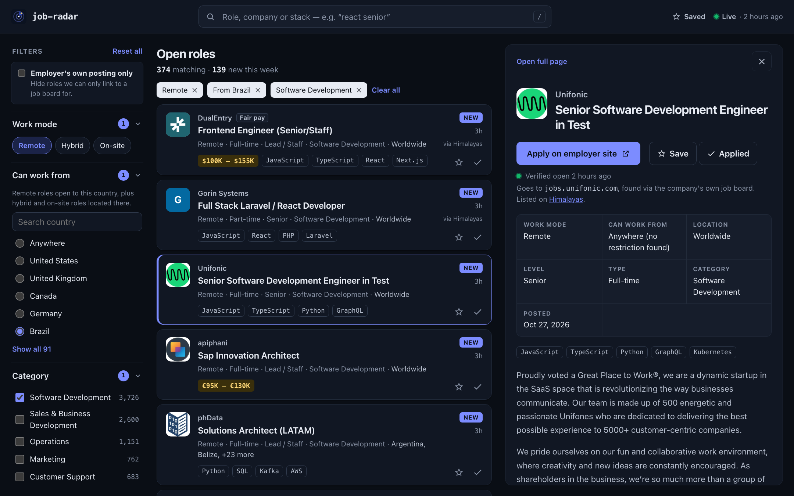

# job-radar

**Real, current job openings, straight from employers' career pages.**

### 👉 [radar-de-vagas.fly.dev](https://radar-de-vagas.fly.dev)



Most job boards are full of listings that closed months ago, reposts of
reposts, and "Apply" buttons that lead to yet another job board. job-radar
reads employers' own hiring pages twice a day, keeps only roles that are
still open, and sends you to the employer's own posting whenever it can.

## What you can do

- 🔎 **Search** thousands of open roles by title, company or stack
  (`react senior`, `golang`, `nubank`).
- 🌎 **Filter by where you can work from**: "Remote" is parsed into the
  countries a role actually accepts, so *Brazil* shows remote roles open to
  Brazil plus hybrid and on-site roles located there.
- 💰 **Filter by salary and pay band**: salaries are read from the postings,
  and each company gets a pay band (Top, High, Fair) from the salaries it
  publishes, never a guess.
- ⚡ **Apply at the source**: "Apply" opens the employer's own posting when it
  can be found and verified, not an intermediate board.
- 👀 **Preview without losing your place**: on wide screens, click a role to
  read it beside the list.
- ⭐ **Save roles and mark the ones you applied to**, with no account: it's
  kept in your browser.
- 🆕 **See what's new** since your last visit and in the last 7 days, for the
  filters you're using.

## How it works

```
Employer hiring pages                 Job boards
(Greenhouse, Lever, Ashby, InHire)    (Himalayas, Jobicy, Arbeitnow, Remotive)
              │                                   │
              └──────────── twice a day ──────────┘
                               │
          normalize: category, level, work mode, salary, countries, stack
          deduplicate: one copy per opening, the employer's copy first
          close: roles that left the employer's page
          resolve: find the employer's own posting for board listings
                               │
                    SQLite ── API ── React UI
```

**Built with** Node 22, TypeScript, Express and SQLite (better-sqlite3) on
the backend, and React 19 with Vite on the frontend (no UI or router
libraries).

**Runs on** one Docker image on [Fly.io](https://fly.io) (São Paulo region):
the backend serves the API and the built frontend, with the database on a
volume. Every pull request runs the checks in GitHub Actions, and merging to
`master` deploys automatically, followed by a smoke test of the live site.

## Under the hood

The UI is a search-first workspace: filters in a sidebar (a full-screen sheet
on phones), removable filter tokens, and on wide screens a list + preview
split view whose selection is part of the URL (`?job=…`).

## Why the jobs are "real and updated"

| Problem with typical boards | What job-radar does |
| --- | --- |
| Stale listings that stay up for months | Each company's job board is read **in full**. A job that disappears from it is closed at the next run. Jobs from partially-read feeds are closed after `STALE_AFTER_DAYS` (default 30) without being seen, or at the source's expiry date. |
| "Apply" leads to another job board | For job-board listings, job-radar looks for **the employer's own posting** and links "Apply" there (see below). |
| Reposts of reposts | Postings come from the employer's own ATS (Greenhouse, Lever, Ashby) first. When the same opening also appears on an aggregator, only the ATS copy is shown (see `recomputeCanonical`). |
| "Remote" that isn't open to you | Locations are parsed into ISO country lists (regions like *EMEA* and *LATAM* are expanded). The **Your location** filter shows remote jobs open to that country, plus hybrid and on-site jobs located there. |
| No salary info | Salaries come from structured fields (Ashby, Lever, Himalayas, Jobicy) or from pay-transparency text in descriptions ("base salary range is $150,000 – $190,000"). They're annualized to approximate USD for the min-salary filter. |
| Can't tell good payers apart | **Pay band** (Top ≥ $120k, High ≥ $90k, Fair ≥ $50k) is the median of the salaries each company *publishes*, never a guess. Companies with fewer than 2 salaries get no band. (API field: `companyTier` = `S`/`A`/`B`.) |

## Sources

Every source is refreshed **twice a day** by default (`INGEST_INTERVAL_HOURS`,
12). That's plenty, since postings rarely change by the hour, and it stays
well inside every provider's limits. The minimum column is the shortest
interval a source will ever be polled at, even with a smaller setting.

| Source | Kind | Scope per run | Minimum interval |
| --- | --- | --- | --- |
| Greenhouse, Lever, Ashby | Employer ATS | Full board for each company in `backend/src/sources/companies.ts` | 1h |
| InHire | Employer ATS (Brazil) | Remote and hybrid roles of each company in `companies.ts` (one detail request per role) | 6h |
| Himalayas | Aggregator | Newest 1,000 remote jobs (the feed has 100k+) | 1h |
| Jobicy | Aggregator | Up to 500 remote jobs | 2h |
| Arbeitnow | Aggregator | Full feed (Europe-heavy) | 1h |
| Remotive | Aggregator | Public sample feed only (~15 jobs, delayed 24h) | 6h, per its terms |

Aggregator jobs link back to the aggregator's posting, as their API terms
require. Remotive's free API is deliberately small; most volume comes from the
ATS boards.

### Direct links to the employer

Job boards link to their own listing page, so after each ingestion run
(`backend/src/resolve/`) job-radar tries to find the employer's posting for
each board listing. It tries these in order of reliability:

1. **ats-match:** the same opening on an ATS board we already ingest.
2. **description:** a job-specific ATS link inside the description (Lever,
   Greenhouse, Ashby, Workable, Recruitee, SmartRecruiters, Personio,
   Teamtailor, Workday…). Careers homepages don't count.
3. **listing-page:** Remotive's public "Apply for this position" link.
4. **ats-discovery:** the company's public board, found by name ("Lemon.io"
   → `lemonio`, `lemon-io`, `lemon`) on Greenhouse, Lever, Ashby, Workable
   and Recruitee. It's used only if that board has a posting with the same
   title; gender markers and "(Remote)" are ignored, every other qualifier
   must match, and an ambiguous match gives no link.

Every link is checked to still load before it's used. Results are re-checked
weekly, discovered boards are cached per company (no board found → retried
after 14 days), and each run searches at most 200 companies. For a first
backfill, run `npm run resolve -- --discovery-budget=500`.

Not resolved on purpose: Jobicy only exposes the employer URL through a
click-tracking endpoint (its terms ask apply buttons to use the feed URL),
Himalayas blocks automated requests, and many Arbeitnow employers take
applications only through Arbeitnow's own form. Those listings keep
"Apply on <board>" until the posting is found on the employer's board.

> Remotive's API terms ask listings to link back to Remotive. job-radar links
> Apply to the employer but keeps a visible "Listed on Remotive" credit link.
> Review their terms before deploying publicly.

**Adding a company:** find its careers URL (`boards.greenhouse.io/{token}`,
`jobs.lever.co/{token}`, `jobs.ashbyhq.com/{token}` or `{token}.inhire.app`)
and add `{ token, name }` to the matching list in `companies.ts`. Only add
the employer's own board: recruiting agencies and RPOs that post for other
companies stay out. Removing a company closes its jobs on the next run.

**Sources evaluated and left out** (2026-10): Gupy and Remotar (terms forbid
aggregating or republishing their listings), Jobgether (reposts employer jobs
behind sign-in and upsells), FlexJobs and Virtual Vocations (paywalled),
Remote.co and Wellfound (their jobs come from employer ATSs, and they block
automated access), Remote OK (hides the employer link), Upwork, Fiverr,
Freelancer.com, PeoplePerHour and Contently (freelance marketplaces, not
jobs), Working Nomads (small feed, mostly gig sign-ups).

**Safeguards:** postings that are résumé pools ("Banco de Talentos", "Talent
Pool", "General Application") are never listed. A board that suddenly lists
under half of its open jobs is treated as a glitch, and nothing is closed
that run.

## Structure

```
backend/   Node 20+ · TypeScript · Express · SQLite (better-sqlite3)
  src/sources/     one adapter per source (fetch + map only)
  src/normalize/   category, seniority, employment type, salary, location, skills, dedup keys
  src/ingestion/   pipeline (upsert/close/retire/dedup/tiers), scheduler, CLI
  src/api/         GET /api/jobs, /api/jobs/:id, /api/stats
frontend/  React 19 · TypeScript · Vite (no router/UI libraries)
```

## Running it

```bash
cd backend && npm install && npm run ingest -- --force   # first fill (~30s)
npm run dev                                              # API on :3001, scheduler on
```

```bash
cd frontend && npm install && npm run dev                # UI on :5173, proxies /api
```

The API checks for due sources on startup and every `SCHEDULER_TICK_MINUTES`
(default 60). A source is due once `INGEST_INTERVAL_HOURS` (default 12) have
passed since its last run, so restarts don't cause extra fetching. Other settings:
`PORT`, `DB_PATH`, `STALE_AFTER_DAYS`, `SCHEDULER=off`, `RATE_LIMIT_PER_MINUTE`
(default 180 API requests per visitor per minute), `FRONTEND_DIST` (built
frontend the API serves; default `../frontend/dist`) and `CORS_ORIGIN` (unset
by default: the UI is same-origin, so no other site may read the API). For a
production frontend build, set `VITE_API_URL` if the API isn't same-origin.

`npm run ingest` runs only the sources that are due, then resolves direct
employer links (`--no-resolve` skips that; `npm run resolve` does only that). Pass `--force` to ignore
intervals, and source ids to limit the run (`npm run ingest -- --force lever`).

## API

`GET /api/jobs` returns one deduplicated copy per opening, newest first. All parameters are optional:

| Param | Example | Notes |
| --- | --- | --- |
| `q` | `react senior` | every word must match title/company/skills/tags, spelling-insensitive (`frontend` = `Front-End`) |
| `category` | `software-development,design` | ids from `/api/stats` |
| `country` | `BR` | eligible to work from (see above) |
| `workplace` | `remote,hybrid` | `remote` · `hybrid` · `onsite` |
| `seniority` | `senior,lead` | `intern` · `junior` · `mid` · `senior` · `lead` · `executive` |
| `type` | `full_time,contract` | employment type |
| `skills` | `TypeScript,Go` | any of |
| `tier` | `S,A` | company pay band (`S` top, `A` high, `B` fair) |
| `minSalary` | `100000` | ≈ USD/year; jobs without a salary are excluded |
| `postedWithin` | `7` | days |
| `direct` | `true` | only jobs whose Apply goes to the employer's own posting |
| `source`, `company` | `ashby`, `openai` | `source` shows that source's own copies (no dedup) |
| `page`, `pageSize` | `2`, `20` | `pageSize` ≤ 50 |

Every job has `url` (the source listing), `applyUrl` (the employer's posting
when known, otherwise `url`) and `applyDirect`.

`GET /api/jobs/:id` returns the full job (plain-text description), plus
`closedAt`, `applyMethod` (how the direct link was found) and `alsoOn`
(other sources listing the same opening).
`GET /api/stats` returns totals, facet counts, the countries present, and each
source's last run.

## Checks

```bash
cd backend && npm run typecheck && npm test
cd frontend && npm run lint && npm run typecheck && npm test && npm run build
```

## Operations

`/health` only says the process is alive. To notice when ingestion stops,
the [Freshness](.github/workflows/freshness.yml) workflow runs every 4 hours,
reads `lastUpdatedAt` from `/api/stats` and fails if it is more than 26 hours
old (or the request fails). GitHub e-mails the person who last edited that
workflow when a scheduled run fails. To try it by hand, run it from the
Actions tab with a small `max_age_hours` (e.g. `0.01`), which should fail.

## Known limitations

- Classification (category, seniority, stack) is rule-based, covering English
  and Portuguese (plus some German), matched without accents. It's right for
  the large majority of postings, but not all. Seniority is left empty rather
  than guessed.
- Country detection knows the countries, regions and major cities listed in
  `normalize/location.ts`. An unknown city on an on-site job means it won't
  match a country filter.
- Salary conversion uses static, approximate exchange rates and is only used
  for filtering. Salaries are always displayed in the original currency.
- Himalayas posts jobs faster than a twice-daily 1,000-job window can cover,
  so its jobs are a sample, not the full feed.
